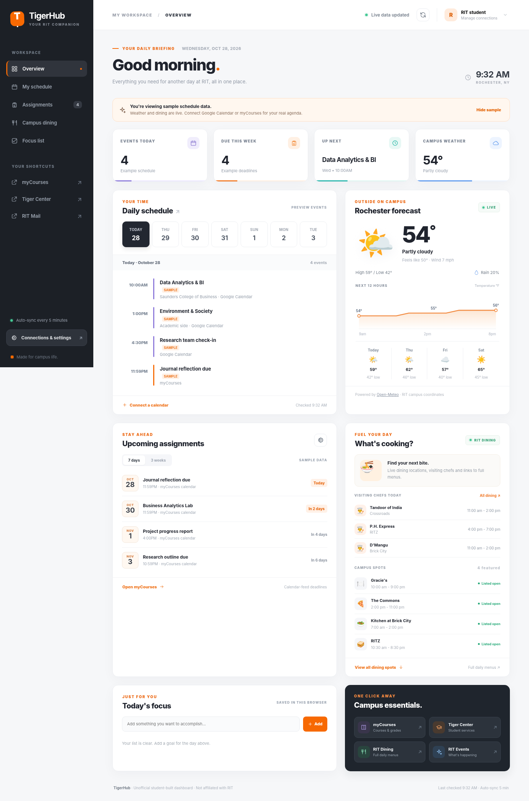

# TigerHub — live RIT student dashboard

A responsive, deployable **personal student homepage** for Rochester Institute of Technology. It combines Google Calendar, your myCourses/Brightspace calendar feed, a second optional iCal feed, live RIT Dining information, Rochester campus weather, and a browser-saved focus list.



> **Status:** The app and its integrations are implemented and tested with local/simulated data. **It is not pre-connected to your private RIT account or already published online.** You must authorize Google and supply your own private Brightspace feed link. The screenshot displays explicitly labeled *sample schedule* entries and simulated weather/dining data for demonstration. A real deployment fetches current weather and dining information automatically.

## What is live, and where it comes from

| Feature | Source | How it updates |
|---|---|---|
| Calendar appointments | Google Calendar API (read-only OAuth) | Reads selected calendars on page load and every 5 minutes while open |
| Course dates and detected deadlines | myCourses's Brightspace **Subscribe** iCal URL | Fetches the private calendar feed server-side every 5 minutes |
| Another calendar | Optional Outlook/iCloud/other allowlisted `.ics` subscription | Fetches every 5 minutes |
| Current weather and 4-day outlook | Open-Meteo for RIT/Henrietta (43.0847, -77.6744) | Rechecked every 5 minutes, with 10-minute server-side caching |
| Campus dining | Official [RIT Dining](https://www.rit.edu/dining/) page | Rechecked every 5 minutes with 5-minute server-side caching |
| Personal focus list | Your browser's local storage | Saves whenever you add, check off, or delete a task |

**Important menu limitation:** RIT's public pages list current dining locations, visiting chefs and operating-hour information, but some **individual menu items/daily specials are delivered by RIT's separate interactive menu service**. TigerHub displays live visiting-chef schedules and campus dining status when the published HTML is available, plus reliable links to the [official full menus](https://www.rit.edu/dining/menus). It does **not** currently ingest the complete meal-by-meal list of dishes; do not rely on the cards for allergen information.

**Important assignment limitation:** Brightspace iCal is not an official full myCourses API integration. It sees dates and events present in the Brightspace calendar; teachers can publish assignments elsewhere without a matching calendar entry. The dashboard labels likely due dates using event titles, and does not know your submission/completion status. Continue checking myCourses for official requirements.

## 1. Run it locally (Mac or PC)

Install Python 3.11+ (3.12 recommended), extract the ZIP, and open Terminal in the `tigerhub-dashboard` folder.

```bash
python3 -m venv .venv
source .venv/bin/activate            # Windows PowerShell: .venv\Scripts\Activate.ps1
pip install -r requirements.txt
cp .env.example .env                 # Windows: copy .env.example .env
```

Edit `.env` and set a strong unique `DASHBOARD_SECRET` (generate with `python -c "import secrets; print(secrets.token_urlsafe(48))"`). For the initial local preview you can leave `GOOGLE_CLIENT_ID` and `GOOGLE_CLIENT_SECRET` empty and **temporarily leave `ALLOWED_EMAIL` empty**. Weather/dining will try to fetch live data and you'll see clearly marked sample events. To connect a private Google account, complete step 3.

```bash
uvicorn app:app --reload --env-file .env
```

Open **http://localhost:8000** in a browser. Click **Connections & settings** for integration setup.

## 2. Connect myCourses (Brightspace)

This uses RIT's standard subscription feature — **never enter your RIT password in TigerHub**.

1. Sign in at [mycourses.rit.edu](https://mycourses.rit.edu/).
2. Open **Calendar** (typically from the myCourses homepage or navigation).
3. Open **Settings**, enable **Calendar Feeds**, and save.
4. Return to Calendar and select **Subscribe**.
5. Choose **All Calendars and Tasks** (best option when offered), then copy the **subscription URL**. It may begin with `webcal://`; TigerHub automatically converts that to secure HTTPS.
6. In TigerHub, open **Connections & settings**, paste the link in the myCourses field and click **Save feed**.

Use the **Subscribe URL**, not a static one-time `.ics` download. If no `Subscribe` option is visible, check the Calendar settings; RIT's Brightspace layout and enabled features can change. If the feed fails, contact RIT support to confirm calendar-feed access for your account.

The subscription URL contains a private token. It is encrypted in an HTTP-only cookie in **that browser**, so you need to connect again on another device or after clearing cookies. Never commit a subscription link to GitHub, copy it into public source code, or share it in screenshots.

## 3. Connect Google Calendar with secure OAuth

Because RIT provides Google Workspace to student accounts, this is the recommended personal calendar connection. **RIT credentials are entered only on Google's actual login page**, never in the dashboard.

1. Open [Google Cloud Console](https://console.cloud.google.com/) and create/select your own project.
2. In **APIs & Services**, enable **Google Calendar API**.
3. Configure the **OAuth consent screen**. For an individual project, choose External + Testing if necessary and add your RIT Google email as a **test user**. Request the Calendar **read-only** scope `https://www.googleapis.com/auth/calendar.readonly`. Google may require additional consent/configuration because this scope can be sensitive.
4. Create an **OAuth 2.0 Client ID** with application type **Web application**.
5. Add the exact authorized redirect URI:
   - Local: `http://localhost:8000/auth/callback`
   - Published: `https://YOUR-DASHBOARD-DOMAIN/auth/callback`
6. Copy your Google **Client ID** and **Client secret** into your server's `.env` or secure hosting environment variables. Do **not** place these values in `static/` files.
7. Set `ALLOWED_EMAIL=your-RIT-google-email@rit.edu` so no other Google user can connect private feeds on your instance.
8. Restart the server, click **Connect** in TigerHub, and authorize your Google account.

If Google says the app is unverified or access is blocked, check test-user configuration and any RIT Workspace admin restrictions. Google OAuth in **Testing** mode may require reauthorization periodically (commonly after 7 days for externally testing apps). Google API access is independent of the dashboard code; authorizing a ChatGPT calendar connector is **not** a substitute for configuring this OAuth app.

## 4. Publish it as a website (Render)

Render can run the Python server and provide HTTPS, so the dashboard can be bookmarked as an ordinary website.

1. Create a **private** GitHub repository and upload all project source files (do not upload `.env`; `.gitignore` excludes it). This code is for a personal project, not an official RIT product.
2. Sign into [Render](https://render.com/) and select **New → Blueprint**, connect your repository, and use the included `render.yaml`. Alternatively create a Python Web Service with `pip install -r requirements.txt` as the build command and `uvicorn app:app --host 0.0.0.0 --port $PORT` as the start command.
3. Add these secure environment variables in Render:

   | Variable | Value |
   |---|---|
   | `BASE_URL` | Your exact HTTPS service URL, e.g. `https://your-tigerhub.onrender.com` (no trailing `/`) |
   | `DASHBOARD_SECRET` | A securely generated random string; keep it constant to retain cookie access |
   | `GOOGLE_CLIENT_ID` | Your OAuth Web application client ID |
   | `GOOGLE_CLIENT_SECRET` | Your OAuth client secret |
   | `ALLOWED_EMAIL` | **Your exact authorized Google account address** |

4. Save environment variables and deploy/redeploy. Add `https://your-tigerhub.onrender.com/auth/callback` to the Google OAuth client's **Authorized redirect URIs**.
5. Open the live Render URL, sign in with Google, and add your myCourses calendar feed in settings. Bookmark the website or add it to your phone's home screen.

`render.yaml` chooses Render's free web plan (if available for your account/region). Free services may sleep and take time to wake on the first visit; check current Render pricing and usage policies. This project does not require a database.

You can similarly deploy on Railway, Fly.io, a private VPS, etc., as long as the server offers HTTPS, environment variables, and Python 3.11+.

## Security and privacy

- Google OAuth uses PKCE + state validation and requests **read-only** access. The server encrypts the resulting tokens in HTTP-only cookies.
- myCourses and optional iCal feed URLs are also encrypted in HTTP-only cookies, and are fetched **server-side**. Browser JavaScript never receives the full private URLs or OAuth access tokens.
- The server accepts feeds only from allowlisted HTTPS RIT/Brightspace, Google Calendar, Outlook/Office 365, and iCloud hosts, and does not follow URL redirects (helps reduce server-side request abuse).
- Set `ALLOWED_EMAIL` when publicly deployed to ensure only your Google account can access the private feed endpoints. The public page itself may display an empty/sample preview to visitors, but **will not expose your cookies**.
- Every additional browser/device requires its own Google authorization and feed setup. Clearing cookies disconnects feeds; the focus list is held locally and disappears when local storage is cleared.
- No server-side database or analytics is included. Data is not forwarded to an external AI service.
- If a subscription URL or OAuth secret is accidentally exposed, revoke/regenerate it at its source and replace the environment variable or saved feed.

## Adjust the dashboard

- **Colors, styling and layout:** `static/styles.css`
- **Dashboard cards, headings and shortcuts:** `static/index.html`
- **Frontend event filtering and interactions:** `static/app.js`
- **Weather, dining scraper, Google OAuth and API endpoints:** `app.py`
- **iCalendar parsing and recurrence support:** `ical_feed.py`
- **Hosting defaults:** `render.yaml`

To change your favorite dining locations, edit `DINING_SPOTS` in `app.py`. To adjust refresh cadence, update the 300000-millisecond interval in `static/app.js` and the server-side cache lifetimes in `app.py`. RIT Dining's website markup can change at any time; when the parser cannot read it, the dashboard shows a source error and keeps official links available.

## Test

```bash
python -m unittest discover -s tests -v
node --check static/app.js          # Optional: if you have Node.js
```

Eight backend/unit checks cover HTML response, cookie encryption, feed URL allowlisting, Brightspace-style calendar parsing, recurring dates, dining extraction and empty/unconnected states. Browser interactions/layout were separately exercised with sample JSON responses; live third-party credentials and network fetching still require your authorized deployment.

## Unofficial project

TigerHub is a student-built, unofficial project and is **not affiliated with or endorsed by Rochester Institute of Technology, Google or D2L**. Data shown is subject to source availability and can lag source updates. RIT's official myCourses, dining menus and notices remain authoritative.
